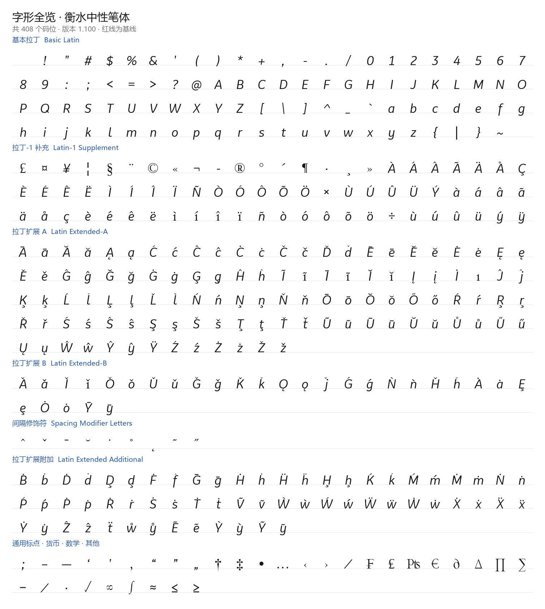
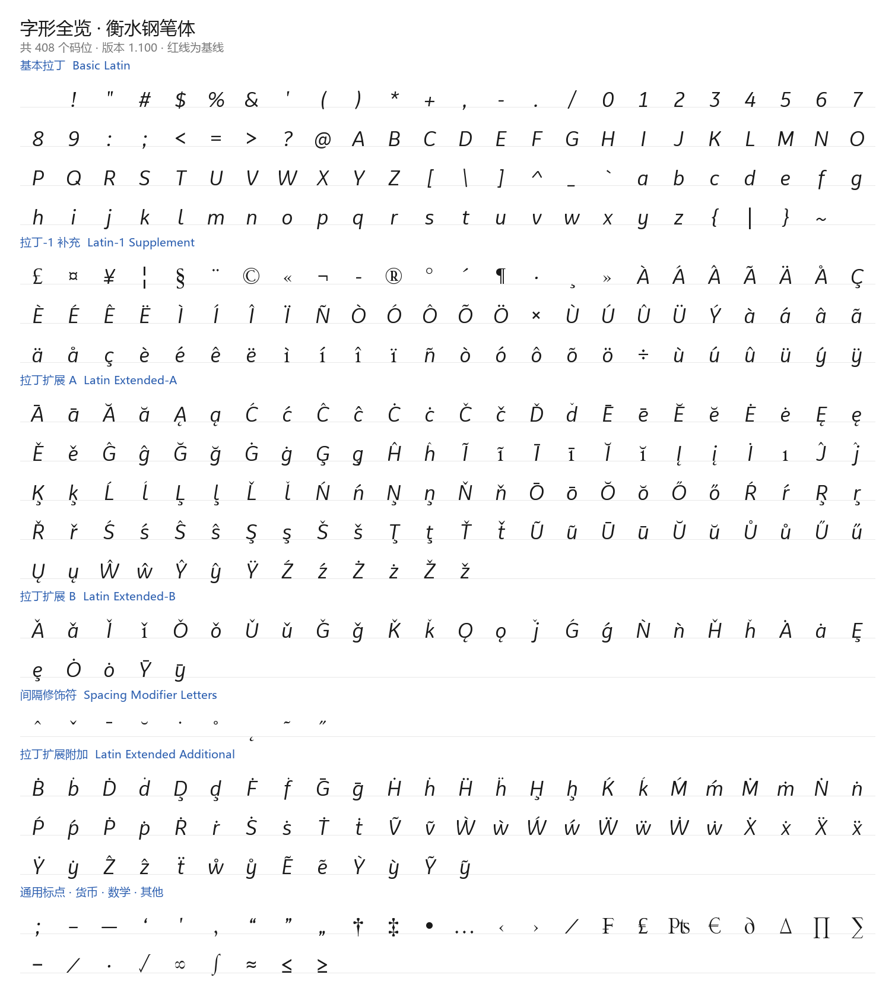
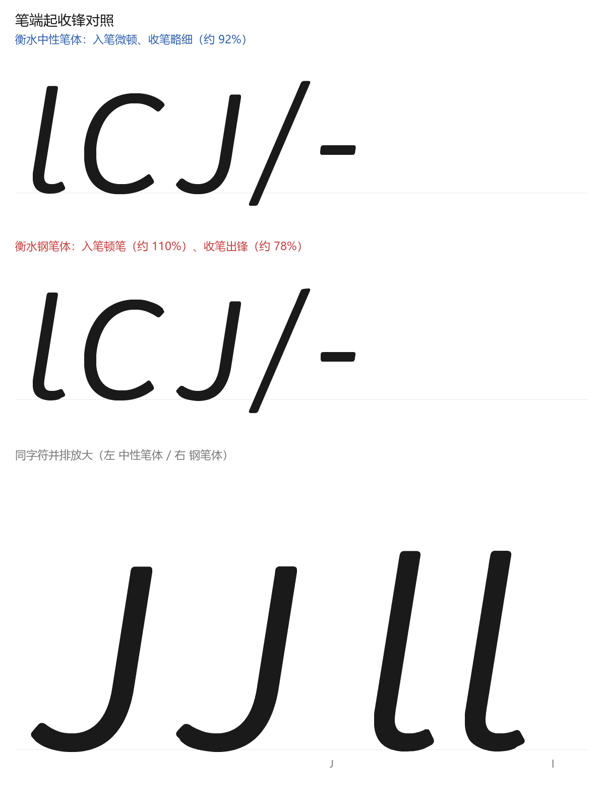
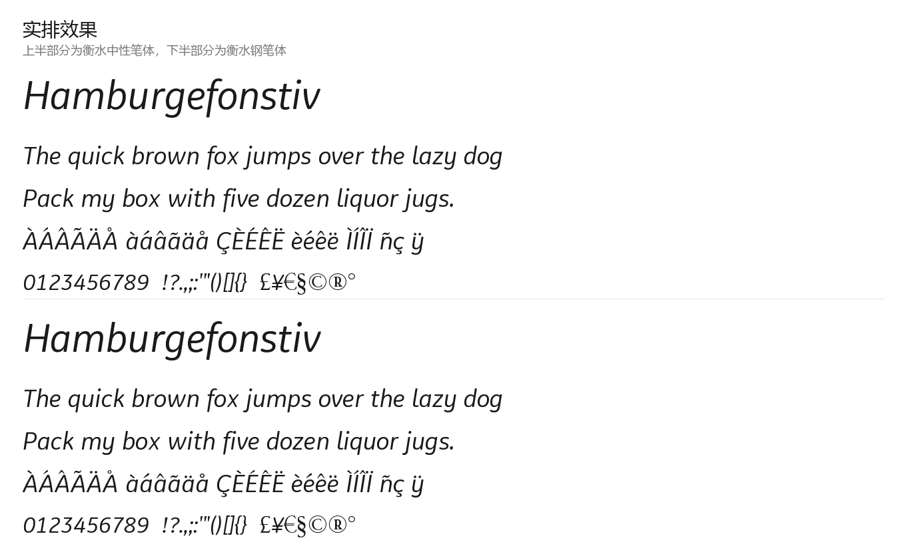

<div align="center">

# 衡水体字体系列

**衡水中性笔体 · 衡水钢笔体**

基于衡水风格英文手写字形，模拟真实笔端起笔与收笔笔锋的西文字体家族


</div>

---

## 项目简介
在中高考英语试卷的书写场景中，**“衡水体”** 已经成为一种被广泛采用的手写印刷体。它因适应中、高考书写规范要求而形成，特点是严谨、整洁、美观，核心书写特征包括无连笔、字形独立、清晰易读。这种字体最初在英文考试作文中流传，后经衡水中学推广而被全国多所中学效仿，逐渐成为应试书写中被教师和阅卷者高度认可的一种规范字形。

衡水体之所以在考试中受到重视，根本原因在于它直接回应了电脑阅卷对书写的刚性要求。答题卡经高速扫描后，潦草、连笔、字母变形或涂改较多的字迹容易模糊不清，即使内容正确，也可能因此损失卷面分。有阅卷老师反馈，卷面整洁、字迹统一的作文更容易被快速识别和定位得分点；反之，辨认成本高的书写则可能在无形中拉低评价。衡水体的规范字形——字母圆润饱满、倾斜角度统一、不连笔、无多余装饰笔画——正是为了在机器扫描和人工阅卷的双重场景下，最大限度保持可读性与卷面整洁感。

本项目提供的两款字体，即基于这一衡水风格英文手写字形构建。基本拉丁字母的字形轮廓逐点保持不变，差异集中在每一笔的**起笔与收笔**两端，分别模拟两种常见硬笔工具的笔触：

- **衡水中性笔体** —— 模拟 0.5 mm 滚珠中性笔：入笔微顿、收笔略细，落笔与提笔利落；
- **衡水钢笔体** —— 模拟金属尖钢笔：入笔顿笔、收笔出锋，末端细长尖锐。

变音字母（é è ñ ü ö ç 等 251 个）由源字形的基字母与变音符号部件**按 Unicode 分解自动合成**，定位与缩放参数由源字形几何实测推导。

两款字体均为 2048 units/em，各覆盖 **408 个字符码位**（非空字形 407 个），适合标题、笔记、手账、板书素材、品牌文案等需要"手写感但不潦草"的场景。

## 字体档案

| 项目 | 衡水中性笔体 | 衡水钢笔体 |
| --- | --- | --- |
| 中文名称 | 衡水中性笔体 | 衡水钢笔体 |
| 英文名称 | `hengshui_gelpen` | `hengshui_fountainpen` |
| PostScript 名称 | `hengshui_gelpen-Regular` | `hengshui_fountainpen-Regular` |
| 完整名称 | hengshui_gelpen Regular | hengshui_fountainpen Regular |
| 版本 | 1.100 | 1.100 |
| 笔端风格 | 滚珠中性笔：短促、圆钝 | 金属钢笔：顿笔、出锋 |
| 入笔 / 收笔 | 入笔约 105%，收笔收细至约 92% | 入笔约 110%，收笔收细至约 78% |
| 出锋锥长 | 约 1.0 × 笔画宽度（封顶 170 单位） | 约 1.0–1.3 × 笔画宽度（封顶 230 单位） |
| 字形数 / 码位数 | 409 / 408 | 409 / 408 |
| unitsPerEm | 2048 | 2048 |
| 嵌入权限 | 0（允许自由嵌入） | 0（允许自由嵌入） |
| 授权 | MIT | MIT |

## 效果预览

### 字符全览 · 衡水中性笔体

红线为基线。



### 字符全览 · 衡水钢笔体



### 笔端起收锋对照

上两排为整字对照：衡水中性笔体与衡水钢笔体同字号排列；下方为同一字符（J、l）两款并排放大，可直接对比入笔顿笔与收笔出锋的形态差异。



### 实排效果




### 已修复的问题

- 早期版本曾出现字距异常（字形整体变窄、字与字挤在一起），原因是像素空间与字体坐标的横纵轴映射颠倒，已改为纯矢量处理；
- 早期版本存在纵向坐标误翻转，导致整批字形落到基线以下、预览显示异常，已按源字形的 y 轴向上约定修正；
- 早期版本把 122 个轮廓为负绕向的字形整体丢弃成空白（含大部分大写字母与数字），已改为按绝对面积选外轮廓、逐轮廓独立处理；
- 早期版本的笔锋判据失效（闭合环判据 100% 命中、笔端位置假设错误），笔锋从未生效；现改为按折返角检测 U 形端帽，251 个开放笔画已正常加笔锋。

## 字符覆盖

每款字体共 **408 个字符码位**（非空字形 407 个，空格无轮廓属正常设计）：

- **基本拉丁字母**：`U+0020–U+007E` 全部 95 个字符（大小写字母、数字、标点、`_`）；
- **拉丁-1 补充区**：U+00A0–U+00FF 中可用的 72 个：£ ¤ ¥ ¦ § ¨ © « ¬ ­ ® ° ´ ¶ · ¸ » À Á Â Ã Ä Å Ç È É Ê Ë Ì Í Î Ï Ñ Ò Ó Ô Õ Ö × Ù Ú Û Ü Ý à á â ã ä å ç è é ê ë ì í î ï ñ ò ó ô õ ö ÷ ù ú û ü ý ÿ（源中本为空的 Æ Ø Ð Þ ß 等未映射，见下）；
- **拉丁扩展 A**：U+0100–U+017F 中 109 个：Ā ā Ă ă Ą ą Ć ć Ĉ ĉ Ċ ċ Č č Ď ď Ē ē Ĕ ĕ Ė ė Ę ę Ě ě Ĝ ĝ Ğ ğ Ġ ġ Ģ ģ Ĥ ĥ Ĩ ĩ Ī ī Ĭ ĭ Į į İ ı Ĵ ĵ Ķ ķ Ĺ ĺ Ļ ļ Ľ ľ Ń ń Ņ ņ Ň ň Ō ō Ŏ ŏ Ő ő Ŕ ŕ Ŗ ŗ Ř ř Ś ś Ŝ ŝ Ş ş Š š Ţ ţ Ť ť Ũ ũ Ū ū Ŭ ŭ Ů ů Ű ű Ų ų Ŵ ŵ Ŷ ŷ Ÿ Ź ź Ż ż Ž ž；
- **拉丁扩展 B**：U+0180–U+024F 中 29 个：Ǎ ǎ Ǐ ǐ Ǒ ǒ Ǔ ǔ Ǧ ǧ Ǩ ǩ Ǫ ǫ ǰ Ǵ ǵ Ǹ ǹ Ȟ ȟ Ȧ ȧ Ȩ ȩ Ȯ ȯ Ȳ ȳ；
- **间隔修饰符**：U+02B0–U+02FF 中 9 个：ˆ ˇ ˉ ˘ ˙ ˚ ˛ ˜ ˝；
- **拉丁扩展附加**：U+1E00–U+1EFF 中 61 个：Ḃ ḃ Ḋ ḋ Ḑ ḑ Ḟ ḟ Ḡ ḡ Ḣ ḣ Ḧ ḧ Ḩ ḩ Ḱ ḱ Ḿ ḿ Ṁ ṁ Ṅ ṅ Ṕ ṕ Ṗ ṗ Ṙ ṙ Ṡ ṡ Ṫ ṫ Ṽ ṽ Ẁ ẁ Ẃ ẃ Ẅ ẅ Ẇ ẇ Ẋ ẋ Ẍ ẍ Ẏ ẏ Ẑ ẑ ẗ ẘ ẙ Ẽ ẽ Ỳ ỳ Ỹ ỹ；
- **通用标点**：`– — ‘ ’ ‚ “ ” „ † ‡ • … ‹ › ⁄` 等 15 个；
- **货币符号**：`¤ ¥ € ₣`；**数学符号**：`∂ ∆ ∏ ∑ − ∕ ∙ √ ∞ ∫ ≈ ≤ ≥` 等 13 个；
- 另含 `ı`（无点 i，用于合成 `í ì î ï`）。

**变音字母的合成方式**：源矢量只含基字母与独立的重音部件（grave 反引号形、´ acute、¨ diaeresis、¸ cedilla、ˆ ˚ ˇ ˘ ˙ ˝ ˛ ˉ ˜ 等）。构建时按 Unicode NFD 把目标字符分解为「基字母 + 组合变音符」，再把重音部件按源字形几何定位到基字母上——上方符号落在字顶之上约一个间隙处，下方符号（`ç` 的 cedilla、`ą` 的 ogonek）挂在基线下；大写因字顶更高，重音按可用空间自动等比缩小，不会顶出字框。

**有意不映射的字符**：源矢量没有独立轮廓、也无法分解合成的字符不写入 cmap，包括 `Æ æ Ø ø Ð ð Þ þ ß`、合字 `fi fl`、`NBSP`、上标数字 `¹ ² ³`、分数 `¼ ½ ¾`、`ª º ¡ ¿`、序号 `№`、商标 `™` 等。不映射是为了让排版系统**自动回退到其他字体**正常显示，而不是在本字体里渲染成空白方块。

## 文件格式说明

每款字体提供 5 种格式，共 10 个文件。

| 扩展名 | 典型体积（中性笔 / 钢笔） | 用途 | 说明 |
| --- | --- | --- | --- |
| `.ttf` | 1314 KB / 1317 KB | 桌面安装、通用 | TrueType 轮廓（二次曲线） |
| `.otf` | 1078 KB / 1083 KB | 设计软件 | CFF 轮廓（三次曲线），字形内容一致 |
| `.woff` | 129 KB / 135 KB | 网页 | TTF 的压缩容器 |
| `.woff2` | 56 KB / 60 KB | 网页（首选） | 压缩率最高，体积最小 |
| `.svg` | 4458 KB / 4462 KB | 数据留存 | SVG 字体，现代浏览器已弃用 |

> 体积较早期版本明显增大，是因为变音字母合成使非空字形从 156 个增至 407 个，且笔锋处理按等弧长重采样加密了轮廓点；`.woff2` 压缩后仅约 60 KB，网页使用不受影响。

> `.woff` / `.woff2` 与 `.ttf` 的字形轮廓、字宽、字符映射完全一致，仅容器不同。
> **SVG 字体自 Chrome 38 起已被浏览器弃用**，该格式主要用于字形数据留存或老工具链，网页请优先使用 `.woff2` + `.woff`。

## 安装

### Windows

双击 `.ttf` 或 `.otf` 文件，点击「安装」（或「为所有用户安装」）。安装后在 Word / Photoshop 等软件的字体列表中选择 **衡水中性笔体** 或 **衡水钢笔体**。

### macOS

双击 `.ttf` / `.otf` 文件，在「字体册」中点击「安装字体」。或把文件复制到 `~/Library/Fonts/`（仅当前用户）或 `/Library/Fonts/`（所有用户）。

### Linux

```bash
mkdir -p ~/.local/share/fonts
cp 衡水中性笔体.ttf 衡水钢笔体.ttf ~/.local/share/fonts/
fc-cache -f -v
```

### 网页 / 小程序 / 设计工具

网页与小程序请使用 `.woff2`（兼容旧环境时叠加 `.woff`）；Figma、Sketch 等设计工具本地安装 `.ttf` 或 `.otf` 即可使用。

## 在网页中使用

把 `.woff2` / `.woff` 文件放到站点目录，然后引入：

```css
@font-face {
  font-family: "hengshui_gelpen";
  src: url("./衡水中性笔体.woff2") format("woff2"),
       url("./衡水中性笔体.woff")  format("woff"),
       url("./衡水中性笔体.ttf")   format("truetype");
  font-weight: 400;
  font-style: normal;
  font-display: swap;
}

@font-face {
  font-family: "hengshui_fountainpen";
  src: url("./衡水钢笔体.woff2") format("woff2"),
       url("./衡水钢笔体.woff")  format("woff"),
       url("./衡水钢笔体.ttf")   format("truetype");
  font-weight: 400;
  font-style: normal;
  font-display: swap;
}

/* 使用 */
h1 { font-family: "hengshui_gelpen", sans-serif; }
.note { font-family: "hengshui_fountainpen", sans-serif; }
```

> 建议 CSS 中的 `font-family` 使用英文名（`hengshui_gelpen` / `hengshui_fountainpen`），避免部分构建工具对中文名处理异常。字体内部同时写入了中文名与英文名：中文环境下显示「衡水中性笔体」「衡水钢笔体」，英文环境下显示 `hengshui_gelpen`、`hengshui_fountainpen`。

## 仓库结构

```
.
├── README.md
├── LICENSE
├── 衡水中性笔体.ttf / .otf / .woff / .woff2 / .svg
├── 衡水钢笔体.ttf   / .otf / .woff / .woff2 / .svg
└── preview/
    ├── 字形全览-中性笔体.png
    ├── 字形全览-钢笔体.png
    ├── 笔端细节对照.png
    ├── 实排效果.png
    └── 与原字形对比.png
```

## 授权协议

本项目（含字体文件本身）以 **MIT License** 发布，可免费用于个人与商业用途，包括再分发与修改。

- 授权全文见仓库根目录的 [LICENSE](LICENSE)；
- 许可信息已写入每个字体文件的名称表：版权声明（name ID 0）、完整 MIT 正文（name ID 13）、许可地址（name ID 14）；
- 嵌入权限 `fsType` 为 `0`，允许在设计软件中自由嵌入，无预览或打印限制。

```
Copyright (c) 2026 Taizhou Jiangyan Zhongyu Information Technology Co., Ltd.
Licensed under the MIT License.
```


---

<div align="center">

**English Summary**

*Hengshui Gel Pen* (`hengshui_gelpen`) and *Hengshui Fountain Pen* (`hengshui_fountainpen`) are two Latin typefaces built on the same Hengshui-style handwritten letterforms. The middle of every stroke follows the source curve; only the **start and end of each stroke** are reshaped — a slight press at the entry and a tapered tip at the exit, blunt for the gel pen and sharp for the fountain pen. Accented Latin letters (é, è, ñ, ü, ç, …) are **composed** from the source base letters and combining accent parts via Unicode NFD decomposition. Each face maps 408 code points (407 visible glyphs) in five formats (TTF / OTF / WOFF / WOFF2 / SVG), licensed under the **MIT License**.

</div>
